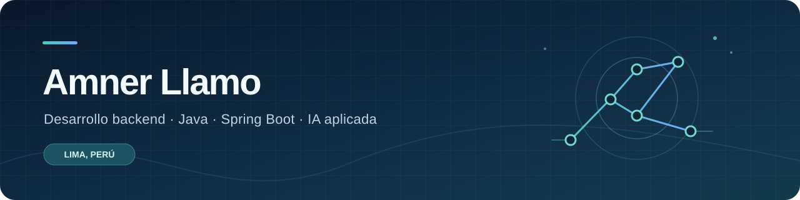

  

  <h1>Hola, soy Amner 👋</h1>

  
<strong>Ingeniero de Software en formación · Backend Java · IA aplicada</strong>

  
Construyo APIs y soluciones que convierten reglas de negocio en herramientas útiles.

  

    
    
  

---

### En qué me enfoco

Trabajo principalmente con **Java, Spring Boot, APIs REST y bases de datos relacionales**. En Turismo CIVA desarrollé funcionalidades para un sistema de recursos humanos. En proyectos personales y académicos he explorado microservicios y aplicaciones de IA generativa con respuestas sustentadas en fuentes.

### Proyectos seleccionados

#### 01 · Compliance Hub

**Proyecto personal full stack** para gestionar cumplimiento normativo. Desarrollé el backend y el frontend, incluida una función RAG que procesa documentos PDF, recupera fragmentos con pgvector y genera respuestas acompañadas de fuentes.

`Java 21` · `Spring Boot` · `Spring AI` · `PostgreSQL` · `pgvector` · `Gemini` · `React` · `TypeScript`

**Explorar:** [Backend](https://github.com/AmnerL/compliance-hub) · [Frontend](https://github.com/AmnerL/compliance-hub-front)

#### 02 · EzPark

**Proyecto académico en equipo.** Fui responsable principal del backend durante la migración de un monolito modular a microservicios. Posteriormente trabajé en una extensión conversacional para consultar disponibilidad y seleccionar estacionamientos.

`Java 17` · `Spring Boot` · `Spring Cloud` · `PostgreSQL` · `Kafka` · `Gemini` · `LangChain4j`

**Explorar:** [Backend](https://github.com/AltixOrganization/EzPark-Web-Service) · [Extensión de IA](https://github.com/AltixOrganization/EzPark-Web-Service/tree/feature/chatbot-integration)

### Herramientas que uso

| Área | Tecnologías |
| :-- | :-- |
| **Backend** | Java, Spring Boot, APIs REST, Spring Data JPA, Hibernate |
| **Datos** | SQL Server, PostgreSQL, pgvector |
| **Frontend** | React, TypeScript |
| **IA aplicada** | Spring AI, RAG, Gemini, LangChain4j |

### Un poco más sobre mí

- 📍 Vivo en Lima, Perú.
- 🎓 Ingeniero de Software en formación en la Universidad Peruana de Ciencias Aplicadas (UPC).
- ☁️ Obtuve la certificación [AWS Certified AI Practitioner](https://www.credly.com/badges/64d0ac09-554d-43b6-8a59-c4e0afd9a8c6/linked_in?t=tm8qn).

  Conoce más sobre mi trabajo en mi <a href="https://amner-portfolio.vercel.app/">portafolio</a>.

